# 1869AC
---
A terminal music player with a bunch of cool features + an online site to play music as well!

### Skip ahead!

* [Code Architecture](##code-architecture)


* [Description](##description)


* [Installation](##installation)


* [Website](##website)


* [Features](##features)


* [Ai Usage](##ai-usage)


* [Learning](##learning)


* [Screenshots](##screenshots)


## Code Architecture

```mermaid
flowchart TD

subgraph group_playback["Terminal Playback"]
  node_cli["Player Startup<br/>[main.py]"]
  node_controls["Playback Controls<br/>[widgets.py]"]
  node_state[("Playback State<br/>[last_played.json]")]
end

subgraph group_playlists["Playlist Management"]
  node_playlistlogic["Playlist Operations<br/>[import_system.py]"]
  node_playlistdata[("Playlist Data<br/>[songs_path.py]")]
end

subgraph group_website["Product Website"]
  node_siteentry["Web App Entry<br/>[main.jsx]"]
  node_siterouter["Page Router<br/>[App.jsx]"]
  node_homepage["Home Page<br/>[home.jsx]"]
  node_featurespage["Features Page<br/>[features.jsx]"]
  node_navigation["Site Navigation<br/>[navbar.jsx]"]
  node_animation["Home Animation<br/>[animation.jsx]"]
  node_dashboard["Dashboard View<br/>[dashboard.jsx]"]
end

subgraph group_accounts["Account Prototype"]
  node_login["Login Flow<br/>[login.jsx]"]
  node_signup["Signup Flow<br/>[signup.jsx]"]
  node_protection["Route Protection<br/>[protected.jsx]"]
  node_authdata["Login Status<br/>[data.jsx]"]
  node_authservice["Auth Operations<br/>[auth.py]"]
  node_supabaseclient["Supabase Client<br/>[supabaseclient.py]"]
end

node_listener(("Listener"))
node_musicfolders["Music Folders"]
node_vlc["VLC Player"]
node_supabase[("Supabase")]

node_listener -->|"starts player"| node_cli
node_cli -->|"imports playlists"| node_playlistlogic
node_cli -->|"reads playlists"| node_playlistdata
node_listener -->|"chooses folder"| node_musicfolders
node_playlistlogic -->|"scans audio"| node_musicfolders
node_playlistlogic -->|"writes playlists"| node_playlistdata
node_cli -->|"syncs imports"| node_playlistdata
node_cli -->|"starts track"| node_vlc
node_cli -->|"reads and writes"| node_state
node_cli -->|"runs controls"| node_controls
node_controls -->|"controls playback"| node_vlc
node_controls -->|"saves progress"| node_state
node_controls -->|"edits playlists"| node_playlistlogic
node_siteentry -->|"renders app"| node_siterouter
node_siterouter -->|"routes to"| node_homepage
node_siterouter -->|"routes to"| node_featurespage
node_siterouter -->|"renders navigation"| node_navigation
node_homepage -->|"renders animation"| node_animation
node_login -->|"uses status data"| node_authdata
node_signup -->|"uses status data"| node_authdata
node_protection -->|"checks status"| node_authdata
node_authservice -->|"uses client"| node_supabaseclient
node_supabaseclient -->|"connects to"| node_supabase

click node_cli "https://github.com/1869ac/1869ac/blob/main/main.py"
click node_controls "https://github.com/1869ac/1869ac/blob/main/widgets.py"
click node_state "https://github.com/1869ac/1869ac/blob/main/last_played.json"
click node_playlistlogic "https://github.com/1869ac/1869ac/blob/main/import_system.py"
click node_playlistdata "https://github.com/1869ac/1869ac/blob/main/songs_path.py"
click node_siteentry "https://github.com/1869ac/1869ac/blob/main/react-stuff/src/main.jsx"
click node_siterouter "https://github.com/1869ac/1869ac/blob/main/react-stuff/src/App.jsx"
click node_homepage "https://github.com/1869ac/1869ac/blob/main/react-stuff/src/home.jsx"
click node_featurespage "https://github.com/1869ac/1869ac/blob/main/react-stuff/src/features.jsx"
click node_navigation "https://github.com/1869ac/1869ac/blob/main/react-stuff/src/navbar.jsx"
click node_animation "https://github.com/1869ac/1869ac/blob/main/react-stuff/src/animation.jsx"
click node_dashboard "https://github.com/1869ac/1869ac/blob/main/react-stuff/src/dashboard.jsx"
click node_login "https://github.com/1869ac/1869ac/blob/main/react-stuff/src/login.jsx"
click node_signup "https://github.com/1869ac/1869ac/blob/main/react-stuff/src/signup.jsx"
click node_protection "https://github.com/1869ac/1869ac/blob/main/react-stuff/src/protected.jsx"
click node_authdata "https://github.com/1869ac/1869ac/blob/main/react-stuff/src/data.jsx"
click node_authservice "https://github.com/1869ac/1869ac/blob/main/react-stuff/tempraory%20py%20files/auth.py"
click node_supabaseclient "https://github.com/1869ac/1869ac/blob/main/react-stuff/tempraory%20py%20files/supabaseclient.py"

classDef toneNeutral fill:#f8fafc,stroke:#334155,stroke-width:1.5px,color:#0f172a
classDef toneBlue fill:#dbeafe,stroke:#2563eb,stroke-width:1.5px,color:#172554
classDef toneAmber fill:#fef3c7,stroke:#d97706,stroke-width:1.5px,color:#78350f
classDef toneMint fill:#dcfce7,stroke:#16a34a,stroke-width:1.5px,color:#14532d
classDef toneRose fill:#ffe4e6,stroke:#e11d48,stroke-width:1.5px,color:#881337
classDef toneIndigo fill:#e0e7ff,stroke:#4f46e5,stroke-width:1.5px,color:#312e81
classDef toneTeal fill:#ccfbf1,stroke:#0f766e,stroke-width:1.5px,color:#134e4a
class node_cli,node_controls,node_state toneBlue
class node_playlistlogic,node_playlistdata,node_supabase toneAmber
class node_siteentry,node_siterouter,node_homepage,node_featurespage,node_navigation,node_animation,node_dashboard toneMint
class node_login,node_signup,node_protection,node_authdata,node_authservice,node_supabaseclient toneRose
class node_listener,node_musicfolders,node_vlc toneIndigo
```

---


## Description
--- 

This is a music player project that has both a terminal + online portion!
* The ***Terminal Porition*** is fully functional at the moment and you can skip ahead, rewind, add multiple different playlists, virtual playlists, shuffle, repeat, and so much more! In the future a login page will also be added to cloud save playlists!

* The ***Website portion*** has begun development and is not functional! At the moment its got cool css + a really cool home page! It also has a functional login and signup page. The features page is outdated - but does features some of our terminal projects coolest features! In the future this part of the project will also be able to play music and save playlists (recreating spotify hehe)

* **Github: ** https://github.com/1869AC/1869AC

* **Website: ** https://thepillu.site

## Installation
---
A guide for how to install our terminal portion! It ought to work for mac, linux, and windows OS!

### Mac/Linux
---

```
brew install --cask vlc
brew trust mrpeng4/tap
brew tap mrpeng4/tap
brew install ac1869
1869ac
```

### Windows
---

1. Install Python 3.12 or newer (tick "Add Python to PATH" in the installer)
2. Install the 64-bit VLC media player from https://www.videolan.org/vlc/ (it has to match your Python, so 64-bit with 64-bit)
3. Open a terminal in this folder and run:

```
pip install -r requirements.txt
python main.py
```

Windows Terminal (the default terminal on Windows 11) shows the player symbols best.
Your `songs_path.py` stores full file paths, so don't copy it between Mac and Windows. Start with an empty one and import your music folder again.

## Website
---

Be sure to check out the work in progress site as well! 
```
https://thepillu.site
```
## FEATURES 
---

* A mermaid flow chart 

* The Terminal app provides a lot of very speficic music functions! Here are them all! :

[Space] or [K] : Play / Pause                 | [Z]            : View Songs in Current Playlist
[Q]            : Quit Player                  |    [Q]            : Quit song selector
[H]            : Open/Close Help Menu         |    [M]            : Cycle through the songs Downwards
[M]            : Next Song                    |    [N]            : Cycle through the songs Upwards
[N]            : Previous Song                |    [Enter]        : Play the selected song
[D] or [l]     : Fast Forward 10 seconds      | [X]            : Change Playlist
[A] or [j]     : Rewind 10 seconds            |    [`]        : Entering this key exits you out of the selector
[P]            : Volume Up                    | [C]            : Import New Folder / Playlist
[O]            : Volume Down                  |    [`]        : Entering this key exits you out of the selector
[0]            : Mute Toggle                  | [V]            : Create Virtual Playlist
[S]            : Toggle Shuffle               |    [Enter]        : Mark / Unmark song (then [F] to finish)
[E]            : Toggle Repeat (Auto / One)   | [B]            : Delete Playlist
                                              | [I]            : Import Single Song (virtual only)
                                              | [R]            : Remove Song (virtual only)

* Works  on mac, linux, and windows! (cross compatibility was hard to achieve)

* The website has a signup/login page and cool homepage animations and css at the moment! There is also an (outdated) features tab and instructions for how to clone the project (also outdated as now we have installation instructions!) This is a heavy work in progress!

## Ai Usage
---

* Ai was not used in generating any of the core concepts that are currently featured in this project. 
* Howver one file that is not being implemented right now that was for themes is AI generated. It is under temporary py files!
* Ai was not used in generating any of our media and art as well! 

## Learning
---

* A lot was learned from this project (after all we've been working on this for a prettty long time!)

### jyoshita
---

* I learned how to use python and a lot of cool syntax (like for detecting keypresses, using supabase in python whyyy is it different, using try catch blocks in python, mscvrt a bit and much more!), and in javascript i got to hone my skills more ! I learned about a cool website called  Ascii motion - https://www.ascii-motion.com/ - that makes ascii animations for you. In the end they did not really end up serving our needs tho so a lot of it had to be rewritten by justmischeif! :D I had a lot of fun on this project and learned a lot over all 

## Screenshots
---

**website**

**terminal**
