# 1869AC
it is just natural code for the music player

## Code Architecture

```mermaid
flowchart TD

subgraph group_playback["Terminal Playback"]
  node_cli["Player Startup<br/>[main.py]"]
  node_controls["Playback Controls<br/>[widgets.py]"]
  node_state[("Playback State<br/>[last_played.json]")]
end

subgraph group_playlists["Playlist Management"]
  node_playlistlogic["Playlist Operations<br/>[import_system.py]"]
  node_playlistdata[("Playlist Data<br/>[songs_path.py]")]
end

subgraph group_website["Product Website"]
  node_siteentry["Web App Entry<br/>[main.jsx]"]
  node_siterouter["Page Router<br/>[App.jsx]"]
  node_homepage["Home Page<br/>[home.jsx]"]
  node_featurespage["Features Page<br/>[features.jsx]"]
  node_navigation["Site Navigation<br/>[navbar.jsx]"]
  node_animation["Home Animation<br/>[animation.jsx]"]
  node_dashboard["Dashboard View<br/>[dashboard.jsx]"]
end

subgraph group_accounts["Account Prototype"]
  node_login["Login Flow<br/>[login.jsx]"]
  node_signup["Signup Flow<br/>[signup.jsx]"]
  node_protection["Route Protection<br/>[protected.jsx]"]
  node_authdata["Login Status<br/>[data.jsx]"]
  node_authservice["Auth Operations<br/>[auth.py]"]
  node_supabaseclient["Supabase Client<br/>[supabaseclient.py]"]
end

node_listener(("Listener"))
node_musicfolders["Music Folders"]
node_vlc["VLC Player"]
node_supabase[("Supabase")]

node_listener -->|"starts player"| node_cli
node_cli -->|"imports playlists"| node_playlistlogic
node_cli -->|"reads playlists"| node_playlistdata
node_listener -->|"chooses folder"| node_musicfolders
node_playlistlogic -->|"scans audio"| node_musicfolders
node_playlistlogic -->|"writes playlists"| node_playlistdata
node_cli -->|"syncs imports"| node_playlistdata
node_cli -->|"starts track"| node_vlc
node_cli -->|"reads and writes"| node_state
node_cli -->|"runs controls"| node_controls
node_controls -->|"controls playback"| node_vlc
node_controls -->|"saves progress"| node_state
node_controls -->|"edits playlists"| node_playlistlogic
node_siteentry -->|"renders app"| node_siterouter
node_siterouter -->|"routes to"| node_homepage
node_siterouter -->|"routes to"| node_featurespage
node_siterouter -->|"renders navigation"| node_navigation
node_homepage -->|"renders animation"| node_animation
node_login -->|"uses status data"| node_authdata
node_signup -->|"uses status data"| node_authdata
node_protection -->|"checks status"| node_authdata
node_authservice -->|"uses client"| node_supabaseclient
node_supabaseclient -->|"connects to"| node_supabase

click node_cli "https://github.com/1869ac/1869ac/blob/main/main.py"
click node_controls "https://github.com/1869ac/1869ac/blob/main/widgets.py"
click node_state "https://github.com/1869ac/1869ac/blob/main/last_played.json"
click node_playlistlogic "https://github.com/1869ac/1869ac/blob/main/import_system.py"
click node_playlistdata "https://github.com/1869ac/1869ac/blob/main/songs_path.py"
click node_siteentry "https://github.com/1869ac/1869ac/blob/main/react-stuff/src/main.jsx"
click node_siterouter "https://github.com/1869ac/1869ac/blob/main/react-stuff/src/App.jsx"
click node_homepage "https://github.com/1869ac/1869ac/blob/main/react-stuff/src/home.jsx"
click node_featurespage "https://github.com/1869ac/1869ac/blob/main/react-stuff/src/features.jsx"
click node_navigation "https://github.com/1869ac/1869ac/blob/main/react-stuff/src/navbar.jsx"
click node_animation "https://github.com/1869ac/1869ac/blob/main/react-stuff/src/animation.jsx"
click node_dashboard "https://github.com/1869ac/1869ac/blob/main/react-stuff/src/dashboard.jsx"
click node_login "https://github.com/1869ac/1869ac/blob/main/react-stuff/src/login.jsx"
click node_signup "https://github.com/1869ac/1869ac/blob/main/react-stuff/src/signup.jsx"
click node_protection "https://github.com/1869ac/1869ac/blob/main/react-stuff/src/protected.jsx"
click node_authdata "https://github.com/1869ac/1869ac/blob/main/react-stuff/src/data.jsx"
click node_authservice "https://github.com/1869ac/1869ac/blob/main/react-stuff/tempraory%20py%20files/auth.py"
click node_supabaseclient "https://github.com/1869ac/1869ac/blob/main/react-stuff/tempraory%20py%20files/supabaseclient.py"

classDef toneNeutral fill:#f8fafc,stroke:#334155,stroke-width:1.5px,color:#0f172a
classDef toneBlue fill:#dbeafe,stroke:#2563eb,stroke-width:1.5px,color:#172554
classDef toneAmber fill:#fef3c7,stroke:#d97706,stroke-width:1.5px,color:#78350f
classDef toneMint fill:#dcfce7,stroke:#16a34a,stroke-width:1.5px,color:#14532d
classDef toneRose fill:#ffe4e6,stroke:#e11d48,stroke-width:1.5px,color:#881337
classDef toneIndigo fill:#e0e7ff,stroke:#4f46e5,stroke-width:1.5px,color:#312e81
classDef toneTeal fill:#ccfbf1,stroke:#0f766e,stroke-width:1.5px,color:#134e4a
class node_cli,node_controls,node_state toneBlue
class node_playlistlogic,node_playlistdata,node_supabase toneAmber
class node_siteentry,node_siterouter,node_homepage,node_featurespage,node_navigation,node_animation,node_dashboard toneMint
class node_login,node_signup,node_protection,node_authdata,node_authservice,node_supabaseclient toneRose
class node_listener,node_musicfolders,node_vlc toneIndigo
```



## Mac

```
brew install --cask vlc
brew trust mrpeng4/tap
brew tap mrpeng4/tap
brew install ac1869
1869ac
```

## Windows

1. Install Python 3.12 or newer (tick "Add Python to PATH" in the installer)
2. Install the 64-bit VLC media player from https://www.videolan.org/vlc/ (it has to match your Python, so 64-bit with 64-bit)
3. Open a terminal in this folder and run:

```
pip install -r requirements.txt
python main.py
```

Windows Terminal (the default terminal on Windows 11) shows the player symbols best.
Your `songs_path.py` stores full file paths, so don't copy it between Mac and Windows. Start with an empty one and import your music folder again.

## Website

```
https://thepillu.site
```
